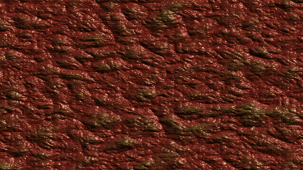
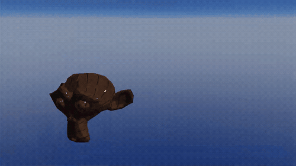
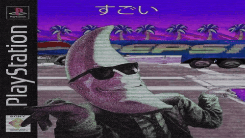

# ✨ ShaderProject

**A visual collection of real-time GLSL shaders exploring procedural art, stylized 3D rendering, vertex manipulation, and retro post-processing.**

 

[Overview](#-overview) •
[Shader Showcase](#-shader-showcase) •

---

## 🎨 Overview

**ShaderProject** is a curated showcase of custom GLSL shaders built from scratch. Each branch explores a distinct visual style—from creepy organic surfaces and fiery image dissolves to retro CRT television filters, procedural mountain landscapes, 2D animated skies, stylized cartoon lighting, and morphing 3D geometry.

---

## 🌟 Shader Showcase

### 1. Biocreep
> **Branch:** `biocreep`

  

- **Techniques:** Procedural noise layering, dynamic normal mapping, and surface lighting.

---

### 2. Burning Image
> **Branch:** `burning_image`

  

- **Techniques:** Noise-driven dissolve thresholding, glowing ember edge detection, and color gradient mapping.

---

### 3. Cell Shading
> **Branch:** `cell_shading`

  

- **Techniques:** Quantized lighting steps, posterized diffuse calculations, and outline rendering.

---

### 4. CRT Effect
> **Branch:** `crt_effect`

  

- **Techniques:** Scanline overlay patterns, screen curvature distortion, and vignette shading.

---

### 5. Procedural Landscape
> **Branch:** `main` / `procedural-landscape`

  

- **Techniques:** Multi-octave FBM terrain generation, parallax scrolling layers, and exponential fog.

---

### 6. Procedural Cloudy Day (SDF)
> **Branch:** `cloudy-day-sdf-project`

  

- **Techniques:** 2D Signed Distance Fields (SDF), polynomial smooth minimum blending, and dynamic sky gradient transitions.

---

### 7. Toon Shading
> **Branch:** `toon-shading`

  

- **Techniques:** Stylized ramp texture shading, Fresnel rim lighting, and ambient hemisphere color bounce.

---

### 8. Warped Jelly (Warp Sphere)
> **Branch:** `warp-sphere`

  

- **Techniques:** Real-time vertex displacement shaders, trigonometric wave animation, and depth-based color shifting.

